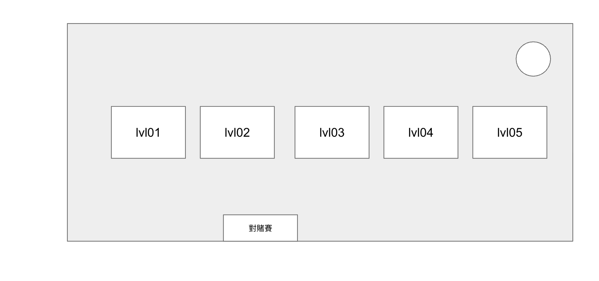

# Blackjack RPG 企劃案：8 Ball Pool 模式移植

本文件概述了如何將《8 Ball Pool》的成功機制（分級場次、裝備驅動、寶箱循環）移植到 21 點 (Blackjack) 遊戲中，打造一款具備高留存率與變現能力的 RPG (Role-Playing Game) 風格博弈遊戲。

## 1. 核心大廳：世界巡迴地圖 (World Tour Map)

捨棄傳統列表，採用橫向卷軸地圖。玩家需逐步解鎖更高級的城市。

### 📍 Level 1: 自家地下室 (Downtown Basement)
- **類型:** 單人連線 / 單人練習 / 自由下注
- **籌碼配置 (Chip Set):** 5, 25, 100, 500, 1000
- **機制:** 自由堆疊籌碼決定下注額 (Flexible Stacking)。
- **特色:** 單人對戰莊家 (1v1)，無時間壓力，無入場費限制。

### 📍 Level 2: 雪梨港灣 (Sydney Harbor)
- **類型:** 多人連線 / 標準規則
- **入場費 (Buy-in):** 2,500 籌碼
- **解鎖條件:** 等級 5 或 贏得 10 場地下室勝利。
- **特色:** 開啟 3 人同桌對戰。開放「表情符號 (Emojis)」互動功能。
- **規則:** 標準 3:2賠率。

### 📍 Level 3: 拉斯維加斯 (Las Vegas Strip)
- **類型:** 多人連線 / 策略進階 / 投降 / 保險
- **入場費 (Buy-in):** 50,000 籌碼
- **特色:** 解鎖進階策略選項，降低波動風險。
- **規則特權:**
  - **投降 (Surrender):** 拿到前兩張牌後可輸一半離場。
  - **保險 (Insurance):** 莊家亮 A 時可購買保險。

### 📍 Level 4: 杜拜皇宮 (Dubai Palace)
- **類型:** 多人連線 / 大戶優勢 / S17停牌
- **入場費 (Buy-in):** 1,000,000 籌碼
- **特色:** 對玩家更有利的頂級規則，吸引豪客 (High Rollers)。
- **規則特權:**
  - **Dealer Stands on Soft 17:** 莊家軟17點不再補牌（玩家勝率微幅提升）。
  - **5-Card Charlie (五龍):** 集滿 5 張牌未爆牌，直接視為勝利 (5 cards unbusted = Win)。

### 📍 Level 5: 蒙地卡羅 (Monte Carlo Casino)
- **類型:** 多人連線 / 傳奇場 / 邊注玩法
- **入場費 (Buy-in):** 50,000,000 籌碼
- **特色:** 極高風險與爆發性獎勵，專為追求刺激的傳奇玩家設計。
- **獨家玩法:** 開放 **Side Bets (邊注)**：
  - **Perfect Pairs:** 賭拿到對子 (最高 25:1)。
  - **21+3:** 結合 Poker 規則 (三條/同花順 最高 100:1)。

## 🔥 獨立模式：對賭賽 (Streak Challenge)

此模式**獨立於世界巡迴**，不需解鎖，玩家隨時皆可進入挑戰。

- **類型:** 連勝挑戰 / 高倍率
- **機制 (Mechanism):** 連續跟莊家玩五把不重置牌 (No Shuffle 5-Hand Streak)。
- **獎勵 (Payout):** 最終輸贏可獲得雙倍到三倍的收益 (2x - 3x Multiplier)。
- **淘汰 (Elimination):** 若前面三把輸了，則提前結束挑戰 (Early Termination if lost initial 3 hands)。

## 2. 裝備系統：幸運戒指 (Lucky Rings)

將《8 Ball Pool》的「球桿」轉換為「戒指」。戒指具有耐久度，需消耗籌碼維修（回收機制）。

### 💍 戒指屬性 (Stats)
- **幸運值 (Fortune):** 增加拿到 Blackjack (21點) 時的額外獎金倍率。
- **回饋力 (Cashback):** 輸掉該局時，有 X% 機率退還部分籌碼。
- **經驗加成 (Experience):** 加速帳號升級，解鎖新地圖。
- **專注時間 (Time Bank):** 延長決策時間。

### 🔋 充能機制 (Recharge)
戒指使用一定局數後會屬性失效，必須花費**籌碼**進行充能。

## 3. 獎勵循環：寶箱系統 (Treasure Chest System)

勝利不只給籌碼，還給予「寶箱」。利用時間牆 (Time Gate) 驅動付費。

- **🥈 銀色寶箱:** 等待 3 小時。內容：少量籌碼 + 普通碎片。
- **🥇 金色寶箱:** 等待 8 小時。內容：中量籌碼 + 稀有碎片。
- **💎 白金寶箱:** 等待 12 小時。內容：大量籌碼 + 必出傳奇碎片。

**變現點:** 玩家可使用綠鈔 (Gems) 立即開啟寶箱。

## 4. 社交與競技 (Social & Competitive)

### 🏆 週聯賽 (Weekly Leagues)
- 每組 50 人，隨機分配。
- 根據「總淨勝籌碼」排名。
- 前 10 名晉級，後 10 名降級。高階聯賽享有「寶箱碎片加成」。

### 🤝 俱樂部 (Clubs)
- 組隊系統。
- 功能：互相贈送體力、協助加速開啟寶箱。

## 5. 介面佈局 (UI Layout)

- **頂部 (Top):** 個人頭像、等級條、籌碼餘額、綠鈔餘額。
- **中央 (Center):** 橫向滑動的世界地圖（佔據 70% 畫面）。每個卡片顯示入場費與獎金。
- **底部 (Bottom):**
  - 🛒 商城 (Shop)
  - 💍 戒指收藏 (Collection) - 升級紅點提示
  - 🎁 寶箱欄位 (Slots) - 倒數計時中
  - 👥 社交 (Social)

## 6. 基礎變現模組 (Monetization Essentials)

- **雙貨幣制:** 籌碼 (Chips) 用於下注與修裝；綠鈔 (Gems) 用於開寶箱與買高階裝。

## 7. 參考圖 (Reference)

