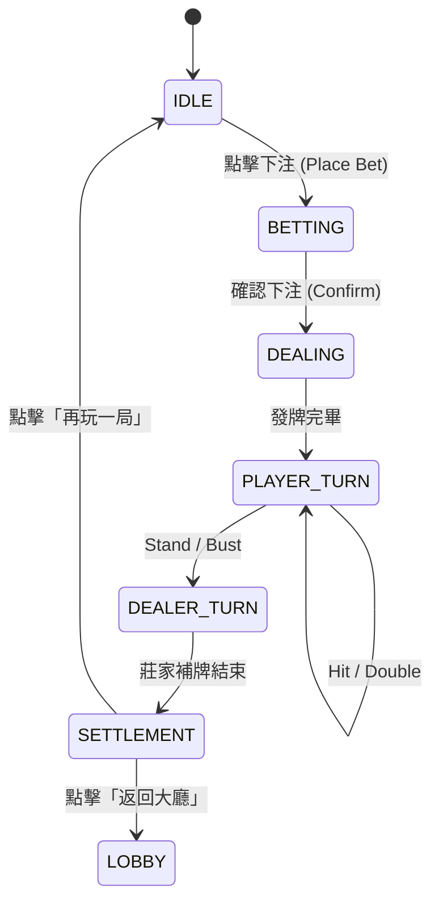

# Blackjack RPG 企劃案：單人對戰莊家 極致體驗版

本文件旨在打造一款專注於 **單人對戰莊家 (1v1 PvE)** 的 Blackjack RPG。透過《8 Ball Pool》式的分級場次與 RPG 成長機制，將簡單的博弈轉化為具備深度、收集慾與成就感的單機進階體驗。

## 1. 核心大廳：世界博弈巡迴 (Single Player World Tour)

捨棄多人房間的等待與混亂，玩家將獨自面對不同城市的傳奇莊家。每個關卡都有獨特的視覺設計與規則優勢。

### 📍 Level 1: 街角地下室 (Downtown Basement)
- **莊家性格:** 謹慎的老手
- **入場資格:** 0 / 自由下注
- **籌碼配置:** 5, 25, 100, 500, 1000
- **特色:** 基礎練習場。提供「新手教學」提示與建議操作
- **解鎖:** 初始開放

### 📍 Level 2: 雪梨港灣別墅 (Sydney Harbor Villa)
- **莊家性格:** 澳洲紳士 (節奏快)
- **入場資格:** 22,500 籌碼
- **籌碼配置:** 100, 500, 1000
- **特色:** 節奏加快。引入「幸運戒指」的首個加成效果

### 📍 Level 3: 拉斯維加斯大理石廳 (Vegas Marble Hall)
- **莊家性格:** 冷酷職業經理人
- **入場資格:** 50,000 籌碼 & 等級 2
- **籌碼配置:** 100, 500, 1000, 3000, 5000
- **優勢規則:** 
  - **投降 (Surrender):** 可拿回一半賭注。
  - **保險 (Insurance):** 對抗莊家 A

### 📍 Level 4: 杜拜雲端賭場 (Dubai Skyscraper)
- **莊家性格:** 頂級人工智慧
- **入場資格:** 1,000,000 籌碼 & 等級 4
- **籌碼配置:** 100, 500, 1000, 3000, 5000
- **優勢規則:** 
  - **5-Card Charlie (五龍):** 5 張牌未爆即勝
  - **S17 Stand:** 莊家軟 17 點必停，對玩家極其有利

### 📍 Level 5: 蒙地卡羅傳奇宮 (Monte Carlo Palace)
- **莊家性格:** 賭神本人 (極高難度)
- **入場資格:** 50,000,000 籌碼 & 等級 6
- **籌碼配置:** 5000, 10000, 20000, 100000, 200000
- **獨家玩法:** **邊注 (Side Bets)** 解鎖，包含 Perfect Pairs 與 21+3
- **視覺:** 背景有極其昂貴的高級藝術品與動態光影效果

## 2. 成長系統：幸運戒指與裝備 (Gear & Progress)

雖然是單人遊戲，但玩家可以透過裝備來「強化」自己的機率與收益

### 💍 戒指屬性 (Single Player Focus)
- **精準度 (Precision):** 提高莊家「爆牌」時的視覺特效華麗度。
- **財富 (Wealth):** 增加 Blackjack (21點) 的賠率 (從 3:2 提升至 3.5:2 等)
- **回流 (Rebate):** 連敗時自動退還 5% 的籌碼作為安慰金
- **XP 增加:** 讓玩家更快升級解鎖下一個高級城市

### 🎒 收藏品：莊家的紀念品
- 擊敗特定城市的莊家多次後，可獲得該地的收藏品（如地標旗幟、特製撲克牌背）
- 收集套裝可獲得永久的籌碼加成

## 3. 核心循環：勝利 -> 寶箱 -> 升級

- **勝利獎勵:** 除了籌碼，100% 獲得一個「技能點數」或「碎片寶箱」。
- **開箱體驗:** 單人遊戲更強調「驚喜感」，寶箱可以開出限定的**牌面外觀**或**桌布紋理**。
- **連勝獎勵 (Hot Streak):** 單人模式下，玩家達成 3/5/10 連勝時，介面會進入「火焰模式 (Frenzy Mode)」，獎勵結算翻倍。

## 4. 社交與競爭 (非多人同步，而是非同步競爭)

- **排行榜 (Leaderboard):** 顯示全球玩家在各關卡的「總勝場」與「最高下注金額」。
- **好友挑戰 (Ghost Mode):** 可以觀看好友的經典對戰回放 (Replays)，並嘗試在同樣的發牌順序下挑戰贏得更多。

## 5. 極致視覺優化 (Premium Visuals)

- **第一人稱視角:** 讓玩家感覺真的坐在桌子對面，莊家有專屬的表情與動作（如拿牌、收牌的手勢）。
- **動態光影:** 根據不同關卡的主題切換環境氛圍。
- **ASMR 音效:** 強化的撲克牌劃過檯面的摩擦聲、籌碼撞擊聲與高級環境背景音。

## 6. 單人專屬：公平證明 (Provably Fair)

- **隨機種子 (Seed):** 玩家可以點擊查看該局的 Hash 值，確保莊家沒有因為是單人模式就對玩家進行演算法控制。

## 7. 技術架構：單人模式狀態機 (Single Player State Machine)

單人模式強調「流暢度」，狀態機設計如下：

- **IDLE/BETTING**: 玩家可在桌面選擇不同面額的籌碼。
- **DEALING**: 此階段為不可中斷的動畫，莊家與玩家依序獲得兩張牌。
- **PLAYER_TURN**: 
    - **HIT**: 玩家要求加牌。
    - **STAND**: 玩家停止加牌。
    - **DOUBLE**: 賭注翻倍並僅加一張牌。
    - **SURRENDER**: 僅在特定場次開放，退一半賭注並結束該局。
- **DEALER_TURN**: 莊家揭牌，並根據該場次規則 (H17/S17) 自動行動。
- **SETTLEMENT**: 顯示勝負、結算籌碼，並計算 XP 與寶箱獲取。

## 8. 前後端通訊協定 (Socket Events)

| 事件名稱 | 方向 | 說明 |
| :--- | :--- | :--- |
| `join_level` | C -> S | 加入特定等級場次 (Level 1-5) |
| `place_bet` | C -> S | 傳送下注金額 |
| `game_start` | S -> C | 回傳初始手牌 (莊家暗牌) |
| `player_action`| C -> S | 傳送 Hit/Stand/Double/Surrender |
| `dealer_action`| S -> C | 傳送莊家補牌過程動畫數據 |
| `round_result` | S -> C | 最終結算 (籌碼變動、XP、掉落寶箱) |

## 9. 單人場次詳細規則表 基礎勝一場得到100點經驗值

| 場次 | 名稱 | 入場費 | 莊家規則 | 特色玩法 | XP 倍數 |
| :--- | :--- | :--- | :--- | :--- | :--- |
| **Level 1** | 街角地下室 | 100 | H17 | 新手導引、無壓力 | 1.0 |
| **Level 2** | 雪梨別墅 | 2,500 | H17 | 獎勵 1.1x XP | 1.1 |
| **Level 3** | 維加斯大廳 | 50,000 | H17 | 加入「投降 (Surrender)」 | 1.25 |
| **Level 4** | 杜拜雲端 | 1M | **S17** | **五龍 (5-Card Charlie)** | 1.5 |
| **Level 5** | 蒙地卡羅 | 50M | **S17** | **五龍 (5-Card Charlie)** + **邊注 (Perfect Pairs)** | 2.0 |

> [!TIP]
> **5-Card Charlie (五龍)**: 玩家只要拿到 5 張牌且未爆牌，不論點數大小直接算贏。這在單人進階場中是非常強大的獎勵機制。

## 10. 裝備系統整合細節

戒指 (Rings) 不是外觀，而是「數值修正」：
- **幸運戒指 (Lucky Ring)**: 提升獲得 Blackjack 的視覺機率（雖然洗牌是公平的，但可透過「重新發牌」機會或加成來體現）。
- **財富戒指 (Wealth Ring)**: 當獲勝時，有 10% 機率獲得額外 1.2x 的籌碼。
- **堅韌戒指 (Hardy Ring)**: 當發生 Bust 時，有極小機率「保險」並退回 10% 賭注。

## 11. 視覺與操作優化 (UX Highlights)

1. **秒發牌 (Turbo Deal)**: 在設定中可開啟，跳過發牌動畫，適合刷進度的玩家。
2. **手勢操作**: 行動裝置支援「點擊桌面」加牌，「橫向滑動」停牌。
3. **沉浸式音效**: 
   - 贏得大筆獎金時的「金幣雨」環境音。
   - 莊家贏球時的「輕蔑語助詞」 (非官方配音，增加沉浸感)。

## 13. 連線與會期管理 (Connection & Session Management)

為了確保遊戲數據的一致性與防止作弊，系統採用以下連線原則：

1. **單一帳號、單一連線 (Kick Old Sessions)**:
   - 同一帳號在同一時間僅能有一個活躍的 Socket 連線。
   - 當新裝置或新分頁登入並建立連線時，伺服器會立即將舊有的連線中斷（Kick），並提示玩家：「您已在其他分頁登入，本對話已被終止。」
2. **連線持久化 (Persistent Socket)**:
   - Socket 連線隨登入啟動，並在大廳與牌桌間持續維持。
   - 這確保了籌碼更新與通知在所有介面間能即時接收。
3. **牌局實例持久化 (Game Instance Persistence)**:
   - 後端以 `userId` 為鍵值儲存遊戲實例 (`GameService`)。
   - 即使 Socket 斷開（例如重新整理或切換分頁），只要玩家在指定時間內重新連線，後端會自動尋回原本的牌局狀態並恢復。
4. **自動回歸視圖 (Auto-Recovery View)**:
   - 當玩家重登或重新連線時，前端會從伺服器取得當前的 `levelId`。
   - 若偵測到玩家正在進行中的牌局，系統會自動將玩家從大廳導向正確的牌桌。

---

## 14. 總結

本文件定義的單人對戰模式，不僅是單純的 21 點遊戲，更是一個具備角色成長與城市經營感的 RPG。透過分級規則與裝備系統，玩家將在不斷挑戰更高難度莊家的過程中，體驗到從賭徒成長為賭神的成就感。
